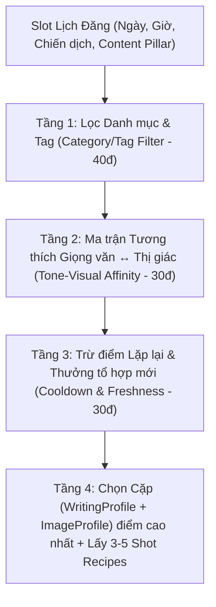
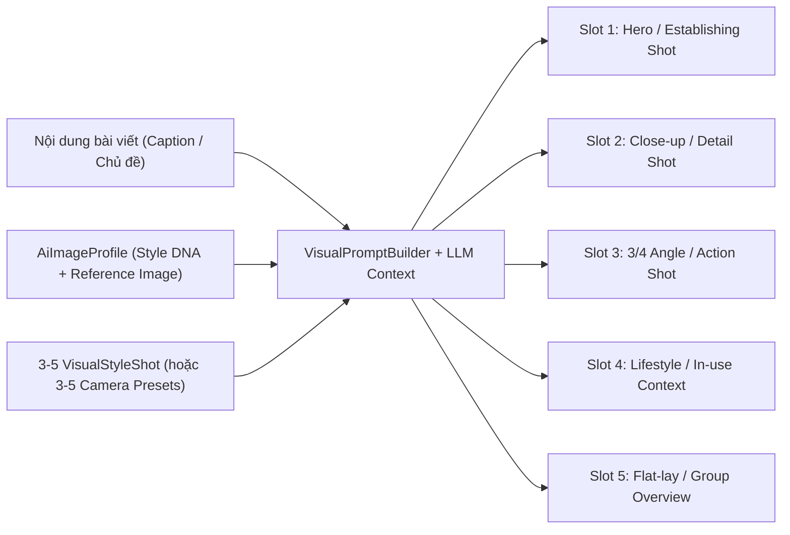

# Kế hoạch Lịch Đăng Bài Tự Động Hàng Tuần (3–5 Bài Facebook/Tuần × 3–5 Ảnh/Bài)

**Cập nhật:** 25/10/2026  
**Trạng thái:** DRAFT — Tài liệu lưu trữ thiết kế & lộ trình triển khai (dùng để tinh chỉnh liên tục).  
**Phạm vi:** Kết nối hệ thống **Văn phong AI (`AiWritingProfile` - ~50 mẫu)**, **Prompt/Phong cách ảnh (`AiImageProfile` / `VisualStyle` - ~20 mẫu)** và **Social Post Scheduler (`/marketing/post-schedule`)** để mỗi tuần tự động sinh **3–5 bài viết Facebook hoàn chỉnh (Content + 3–5 ảnh đa góc chụp)** và đăng theo khung giờ vàng.

---

## 1. Mục tiêu cốt lõi

1. **Tần suất chuẩn cho Fanpage:** Tự động tạo và lên lịch **3–5 bài viết Facebook/tuần** theo các khung giờ vàng đã định sẵn.
2. **Định dạng mỗi bài đăng:**
   - **Content:** Đầy đủ cấu trúc `FacebookContent` (`title`, `body`, `bullet_points`, `cta`, `contact`, `hashtags`) được viết theo đúng Văn phong đã chọn.
   - **Hình ảnh:** Bộ gallery **3–5 ảnh/bài** (`aspect_ratio = 4:5` hoặc `1:1`) đồng nhất về màu sắc/ánh sáng (Style DNA) nhưng **khác nhau về góc chụp (Shot Recipes)** để tạo thành album kể chuyện (storytelling gallery).
3. **Khai thác thông minh kho dữ liệu lớn (50 Văn phong × 20 Prompt ảnh = 1.000 tổ hợp):**
   - Không ghép ngẫu nhiên gây lệch tông (ví dụ: văn phong học thuật đi với ảnh hoạt hình).
   - Không lặp lại nhàm chán cùng một giọng văn hay một màu ảnh liên tiếp trên bảng tin Fanpage.
4. **Khép kín luồng từ UI đến Facebook Graph API:**
   - Cấu hình tại `/marketing/post-schedule` ➔ Tự động tạo nháp & chạy AI ➔ Hàng chờ duyệt (`Review Gate`) ➔ Tự động đăng lên Facebook Page khi đến giờ `scheduled_at`.

---

## 2. Đối chiếu hiện trạng Codebase (3 luồng hiện có & Khoảng trống cần nối)

### 2.1. Tổng hợp 3 luồng đã có trong hệ thống

| Luồng hệ thống | Các file / Service cốt lõi đã có | Trạng thái hiện tại | Khoảng trống cần nối / nâng cấp |
| :--- | :--- | :--- | :--- |
| **1. Luồng Prompt ảnh & Tạo ảnh** | • `app/Models/AiImageProfile.php` • `app/Models/VisualStyleShot.php` • `app/Services/Ai/Images/ImageProfileService.php` • `app/Services/Ai/VisualStyle/VisualStyleAnalyzerService.php` • `app/Services/Ai/VisualStyle/VisualPromptBuilder.php` • `app/Services/Ai/VisualStyle/VisualStyleGenerationService.php` • `app/Services/Ai/Images/AiImageGenerationService.php` • `app/Jobs/ProcessSocialPostImageJob.php` | • Đã có bảng `ai_image_profiles` lưu cả `prompt` phẳng lẫn `dna_json` (composition, camera, lighting, environment, color_mood). • Mỗi style khi phân tích đã tự sinh **3–5 `VisualStyleShot` (góc chụp khác nhau)**. • Đã hỗ trợ truyền ảnh mẫu `reference_media_id` xuống Image Provider. • Đã có gắn `categories()` và `tags()`. | • `SocialPostGenerationService` hiện mới chỉ đọc cột `prompt` phẳng qua `ImageProfileService::snapshot()`, chưa tận dụng `dna_json`, `VisualPromptBuilder` và 3–5 `VisualStyleShot`. • Khi sinh 3–5 ảnh cho Social Post (`SocialPostAiWorkerService::processImagePrompt`), các slot hiện chỉ nối thêm chuỗi `"Variation slot 1..N"` thay vì đổi góc máy theo từng slot. |
| **2. Luồng Văn phong (Writing Profile)** | • `app/Models/AiWritingProfile.php` • `app/Services/Ai/WritingProfiles/WritingProfileAnalysisService.php` • `app/Services/Ai/WritingProfiles/WritingProfileService.php` • `app/Services/Ai/WritingProfiles/WritingProfileSnapshotService.php` | • Hỗ trợ tạo từ bài mẫu (`reference` có kiểm chứng `evidence_json`) hoặc tạo thủ công (`manual`). • Có cấu trúc `rules_json` (`tone`, `pronouns`, `emotion`, `opening`, `sentence_rhythm`, `bullets`, `ending`, `avoid`). • Có `WritingProfileSnapshotService` đóng băng văn phong vào từng lần chạy. | • Chưa có gắn `category` / `tags` hoặc nhãn phân nhóm nhanh (ví dụ: *Hài hước, Chuyên nghiệp, Thân thiện, Bán hàng, Kiến thức, Truyền cảm hứng*) để ghép cặp tự động với kho 20 Style ảnh. |
| **3. Luồng Social Post & Lịch đăng** | • `app/Models/SocialPost.php` (đã có cột `scheduled_at`) • `app/Models/DailyContentPlan.php` • `app/Services/Marketing/SocialPostLifecycleService.php` • `app/Services/Marketing/SocialPostGenerationService.php` • `app/Services/Marketing/SocialPostGenerationStateService.php` • `app/Services/Marketing/SocialPublicationService.php` • `app/Services/Marketing/Publishing/FacebookPublisher.php` • `app/Console/Commands/GenerateDailySocialPostDraftsCommand.php` • UI: `resources/js/pages/marketing/post-schedule/index.vue` & 6 tabs | • Đã có đầy đủ pipeline tạo Caption + Gallery ảnh, kiểm duyệt (`MIN_GALLERY_IMAGES = 3`) và đăng Facebook chống trùng (`idempotency_key`). • Đã có giao diện 6 tab tại `/marketing/post-schedule` (`GeneralTab`, `ScheduleTab`, `ToneTab`, `ImageStyleTab`, `PlatformsTab`, `AdvancedTab`). | • `GenerateDailySocialPostDraftsCommand` đang chạy cố định 2–3 bài/ngày, chưa nhận cấu hình lịch tuần (3–5 bài/tuần) và chưa truyền `writing_profile_id`, `image_profile_id`, `image_count` (3–5), `scheduled_at`. • `FacebookPublisher.php` (dòng 68) đang cắt `array_slice($images, 0, 4)` — cần nâng lên `5` ảnh. • Chưa có command định kỳ quét `scheduled_at <= now()` để tự động publish các bài đã `approved`. • UI `/marketing/post-schedule` đang dùng dữ liệu mẫu tĩnh, chưa nối API. |

---

## 3. Kế hoạch Lịch đăng Tuần (3–5 bài/tuần) & Cấu trúc 3–5 ảnh/bài

### 3.1. Khung Lịch đăng Tuần đề xuất (Weekly Content Calendar)

Mỗi tuần hệ thống vận hành **3–5 slot cố định** trải đều từ đầu tuần đến cuối tuần theo nhịp độ tâm lý người dùng Facebook:

| Slot | Thứ trong tuần | Khung giờ đăng (`scheduled_at`) | Trụ cột nội dung (Content Pillar) | Nhóm Văn phong ưu tiên (`AiWritingProfile`) | Nhóm Phong cách ảnh (`AiImageProfile`) | Số ảnh (`image_count`) | Phân vai 3–5 ảnh trong Gallery (Storytelling Slots) |
| :---: | :--- | :---: | :--- | :--- | :--- | :---: | :--- |
| **1** | **Thứ 2** | **08:00** | **Khởi động tuần mới / Truyền cảm hứng / Đời sống** | **Hài hước** hoặc **Truyền cảm hứng** *(Câu ngắn, dí dỏm, năng lượng tích cực)* | **Photorealistic / Lifestyle** *(Ánh sáng tự nhiên buổi sáng, ấm áp, đời thường)* | **3 ảnh** | • **Slot 1:** Toàn cảnh/Hero không gian buổi sáng • **Slot 2:** Cận cảnh (Close-up) chi tiết chủ thể • **Slot 3:** Góc Lifestyle tương tác tự nhiên |
| **2** | **Thứ 4** | **12:00** | **Chia sẻ kiến thức / Tips / Hướng dẫn hữu ích** | **Chia sẻ kiến thức** hoặc **Chuyên nghiệp** *(Rõ ràng, chia bước, có bullet points)* | **Minimal / Flat Design / Studio Clean** *(Bố cục tối giản, nhiều khoảng trống, tập trung)* | **4 ảnh** | • **Slot 1:** Ảnh Hook mở đầu chủ đề • **Slot 2:** Minh họa góc nhìn / bước 1–2 • **Slot 3:** Minh họa chi tiết / bước 3–4 • **Slot 4:** Ảnh tổng kết trực quan |
| **3** *(Tùy chọn)* | **Thứ 5** | **19:30** | **Câu chuyện thương hiệu / Hậu trường (Behind the scenes)** | **Thân thiện / Kể chuyện** *(Tâm sự nhẹ nhàng, gần gũi, khơi gợi đồng cảm)* | **Cinematic / Vintage / Warm Tone** *(Ánh sáng chiều tối, màu phim có chiều sâu)* | **3 ảnh** | • **Slot 1:** Góc rộng bối cảnh (Wide establishing shot) • **Slot 2:** Khoảnh khắc hoạt động (Medium shot) • **Slot 3:** Đặc tả cảm xúc/chất liệu (Macro/Detail) |
| **4** | **Thứ 6** | **17:30** | **Bán hàng / Giới thiệu sản phẩm chủ lực** | **Bán hàng (Sales)** *(Nêu bật lợi ích ngay dòng đầu, có ưu đãi & CTA rõ)* | **Commercial Product / Food Photography** *(Sắc nét, ánh sáng studio làm nổi bật sản phẩm)* | **5 ảnh** | • **Slot 1:** Hero shot chính diện sản phẩm nổi bật • **Slot 2:** Góc nghiêng 3/4 tôn hình khối • **Slot 3:** Cận cảnh (Macro) chất liệu/chi tiết đắt giá • **Slot 4:** Sản phẩm trong bối cảnh sử dụng thực tế • **Slot 5:** Flat-lay / Combo tổng thể thúc đẩy chốt đơn |
| **5** | **Chủ Nhật** | **09:00** *(hoặc 20:00)* | **Tương tác cuối tuần / Minigame / Ưu đãi nhẹ** | **Hài hước / Thân thiện** *(Vui vẻ, đặt câu hỏi kích thích bình luận)* | **3D Illustration / Cartoon / Vivid** *(Màu sắc tươi sáng, bắt mắt khi lướt feed nghỉ ngơi)* | **3–4 ảnh** | • **Slot 1:** Visual bắt mắt gây tò mò dừng lướt • **Slot 2–3:** Các tình huống / góc nhìn thú vị • **Slot 4:** Lời chúc cuối tuần / Gợi nhắc ưu đãi |

> [!TIP]
> Với cấu hình này:
> - Nếu chọn **3 bài/tuần**: Chạy **Thứ 2 – Thứ 4 – Thứ 6**.
> - Nếu chọn **4 bài/tuần**: Chạy **Thứ 2 – Thứ 4 – Thứ 6 – Chủ Nhật**.
> - Nếu chọn **5 bài/tuần**: Chạy đủ **Thứ 2 – Thứ 4 – Thứ 5 – Thứ 6 – Chủ Nhật**.

---

## 4. Thuật toán Ghép cặp 4 Tầng (Khi có 50 Văn phong × 20 Prompt ảnh)

Khi kho dữ liệu có tới **50 `AiWritingProfile`** và **20 `AiImageProfile`** ($50 \times 20 = 1.000$ tổ hợp), hệ thống sử dụng **`SocialSchedulePairingService`** để chấm điểm và chọn cặp tự động theo 4 tầng:

### Tầng 1: Đồng bộ theo Danh mục / Tag chủ đề (Trọng số: 40 điểm)
- Gắn `category` / `tags` chung cho cả `AiWritingProfile` và `AiImageProfile` (tận dụng hệ thống `categorizables` và `taggables` đã có sẵn trên `AiImageProfile`).
- Nếu Slot lịch đăng chỉ định nhóm chủ đề (ví dụ: `Khuyến mãi / Bán hàng` hoặc `Chia sẻ kiến thức`), hệ thống cộng **+40 điểm** cho các Văn phong và Style ảnh có trùng `category` hoặc `tag` với Slot/Campaign đó.

### Tầng 2: Ma trận Tương thích Giọng văn ↔ Thị giác (Trọng số: 30 điểm)
So khớp tự động giữa `AiWritingProfile.rules_json` (`tone`, `emotion`, `sentence_rhythm`) và `AiImageProfile.dna_json` (`color_mood`, `lighting`, `camera`, `environment`):

| Đặc trưng Văn phong (`rules_json`) | Đặc trưng Style DNA tương thích (+30đ) | Đặc trưng Style DNA xung đột (-30đ / Loại) |
| :--- | :--- | :--- |
| **Hài hước / Bắt trend / Sôi nổi** | `color_mood.saturation` $\in$ `[vivid, high]`, `lighting.intensity` $\in$ `[medium, high]`, hoặc nhóm `3D / Cartoon / Lifestyle` | `color_mood.saturation = desaturated`, `lighting.type = dramatic` u tối |
| **Chuyên nghiệp / Chia sẻ kiến thức** | `composition.negative_space` $\in$ `[moderate, dominant]`, `visual_balance = symmetric`, `environment.type` $\in$ `[studio_solid, studio_gradient]` | Bố cục lộn xộn, góc máy `dutch` nghiêng ngả |
| **Thân thiện / Kể chuyện / Truyền cảm hứng** | `lighting.temperature = warm`, `lighting.type` $\in$ `[golden_hour, natural_window]`, `environment.type` $\in$ `[lifestyle_interior, lifestyle_exterior]` | Ánh sáng `cool` lạnh lẽo, `hard shadows` gắt |
| **Bán hàng (Sales) / Giới thiệu sản phẩm** | `style_constraints.commercial_quality = true`, `camera.shot_type` $\in$ `[hero, product_single, detail]`, `camera.focus = sharp_all` | Ảnh `soft focus` mờ ảo, `extreme_wide` chủ thể quá nhỏ |

### Tầng 3: Chống lặp & Phân bổ đều kho 50 × 20 (Trọng số: 30 điểm)
Truy vấn lịch sử `SocialPostVersion` và `AiImport` trong **30–60 ngày gần nhất**:
1. **Cooldown Văn phong (Writing Profile Cooldown):**
   - Với 50 văn phong, một văn phong vừa được sử dụng sẽ bị phạt điểm trong **10 bài tiếp theo** (đảm bảo ít nhất 2–3 tuần không lặp lại cùng 1 văn phong).
2. **Cooldown Phong cách ảnh (Image Style Cooldown):**
   - Với 20 style ảnh, **cấm tuyệt đối** dùng cùng 1 `image_profile_id` cho 2 bài liên tiếp. Mỗi bài trong cùng 1 tuần bắt buộc có `image_profile_id` khác nhau.
3. **Điểm thưởng Tổ hợp mới (Pair Exploration Bonus):**
   - Cặp `(writing_profile_id, image_profile_id)` nào chưa từng kết hợp với nhau trong 60 ngày qua được cộng **+15 điểm**; cặp nào vừa kết hợp trong 30 ngày qua bị trừ **-20 điểm**.

### Tầng 4: 3 Chế độ vận hành cho Admin trên UI
1. **`auto_smart` (Mặc định):** Tự động chạy thuật toán 3 tầng trên để chọn cặp tốt nhất cho từng ngày.
2. **`rule_by_day` (Theo nhóm từng thứ):** Admin chọn nhóm Văn phong + nhóm Style ảnh cho từng Thứ (ví dụ Thứ 2 = *Hài hước + Lifestyle*, Thứ 6 = *Bán hàng + Studio Product*), hệ thống tự xoay vòng các mẫu trong nhóm đó.
3. **`pinned` (Ghim cố định):** Admin chỉ định đích danh `writing_profile_id` và `image_profile_id` cho một slot cụ thể.

---

## 5. Cơ chế sinh 3–5 ảnh đa góc chụp từ Prompt ảnh đã chọn

Khi đã chọn được `AiImageProfile` (Style ảnh) và số lượng ảnh $K \in [3, 5]$ cho bài viết:

1. **Trường hợp Style ảnh đã có các `VisualStyleShot` (`shots` active $\ge K$):**
   - Lấy $K$ `VisualStyleShot` theo `sort_order`.
   - Với mỗi slot $i \in \{1..K\}$, dùng `VisualPromptBuilder` kết hợp `Style DNA` + `Shot Recipe #i` + chủ đề bài viết + đính kèm `reference_media_id` (nếu có) để sinh ảnh.
2. **Trường hợp Style ảnh chưa có đủ `VisualStyleShot` (hoặc là prompt phẳng):**
   - Hệ thống tự động áp dụng **Bộ 5 Khuôn Góc Chụp Chuẩn (Standard Multi-Shot Presets)** cho từng slot thay vì chỉ ghi `"Variation slot X"`:
     - **Slot 1 (Hero Shot):** `Hero front/three-quarter view, clear focal subject, balanced composition, inviting atmosphere.`
     - **Slot 2 (Detail / Close-up):** `Close-up macro/detail shot highlighting texture, craftsmanship, and key elements, shallow depth of field.`
     - **Slot 3 (Lifestyle / Context):** `Medium-wide lifestyle shot in a natural real-world setting, warm and relatable human/environmental context.`
     - **Slot 4 (Angle Variation):** `Dynamic 45-degree or high-angle perspective showing depth and surrounding props.`
     - **Slot 5 (Flat-lay / Overview):** `Top-down flat-lay or curated overview composition, clean arrangement with harmonious negative space.`

---

## 6. Các hạng mục kỹ thuật cần triển khai (Implementation Tasks)

### Phase 1: Mở rộng Schema & Cấu hình Lịch tuần (Backend Foundation)
- [ ] **Task 1.1:** Bổ sung cột cho bảng `daily_content_plans` (migration mới):
  - `writing_profile_id` (`nullable`, FK ➔ `ai_writing_profiles.id`)
  - `image_profile_id` (`nullable`, FK ➔ `ai_image_profiles.id`)
  - `image_count` (`unsignedTinyInteger`, default `3`)
  - `scheduled_at` (`timestamp nullable` — thời điểm dự kiến đăng bài)
  - `pairing_mode` (`string`, default `'auto_smart'`)
- [ ] **Task 1.2:** Bổ sung cột `category` (hoặc hỗ trợ `HasSlug`/`MorphToMany Category & Tag`) cho `AiWritingProfile` để đồng bộ phân loại với `AiImageProfile`.
- [ ] **Task 1.3:** Định nghĩa cấu trúc lưu cài đặt Lịch đăng tuần trong `Settings` (group `marketing_schedule`):
  - `weekly_target_count`: `3..5` (bài/tuần)
  - `default_image_count`: `3..5` (ảnh/bài)
  - `active_weekdays`: mảng cấu hình theo thứ (ví dụ `mon`, `wed`, `thu`, `fri`, `sun`), mỗi thứ có `time_slot` (`08:00`, `12:00`...), `pillar_category`, `image_count`, `writing_profile_id` (nullable), `image_profile_id` (nullable).
  - `auto_submit_review`: `boolean` (tự động chuyển sang `pending_review` khi AI tạo xong).
  - `auto_schedule_publish`: `boolean` (tự động lên lịch đăng theo `scheduled_at` sau khi `approved`).

### Phase 2: Xây dựng Engine Ghép cặp & Nâng cấp Đa góc chụp 3–5 ảnh
- [ ] **Task 2.1:** Tạo service `App\Services\Marketing\SocialSchedulePairingService`:
  - Thực thi thuật toán 4 tầng (Category/Tag match + Tone-to-DNA affinity + Cooldown 30–60 ngày) để chọn cặp `(AiWritingProfile, AiImageProfile)` tối ưu cho mỗi slot.
- [ ] **Task 2.2:** Nâng cấp `SocialPostContextBuilder` & `SocialPostAiWorkerService`:
  - Tích hợp `VisualPromptBuilder` và `VisualStyleShot` (hoặc 5 Camera Angle Presets) vào `processImagePrompt()` để mỗi slot ảnh (`slot_no = 0..4`) có một prompt góc chụp riêng biệt nhưng giữ nguyên Style DNA.
  - Hỗ trợ truyền `referenceImages` từ `AiImageProfile.reference_media_id` vào `ProcessSocialPostImageJob`.
- [ ] **Task 2.3:** Cập nhật `FacebookPublisher.php`:
  - Nâng giới hạn upload ảnh từ `array_slice($images, 0, 4)` lên `array_slice($images, 0, 5)` (hoặc theo config `social.facebook.max_gallery_images = 5`).

### Phase 3: Tự động hóa Scheduler (Tạo bài theo Tuần & Đăng bài đúng giờ)
- [ ] **Task 3.1:** Nâng cấp `GenerateDailySocialPostDraftsCommand` (`marketing:social-post-drafts`):
  - Đọc cấu hình `marketing_schedule` để kiểm tra ngày hiện tại có slot đăng bài trong tuần không.
  - Gọi `SocialSchedulePairingService` lấy cặp `writing_profile_id` + `image_profile_id` + `image_count` (3–5).
  - Tạo `SocialPost` kèm `scheduled_at` đúng khung giờ của slot và xếp hàng `SocialPostGenerationService::queue()`.
- [ ] **Task 3.2:** Hỗ trợ `auto_submit_review` trong `SocialPostGenerationStateService::refresh()`:
  - Khi cả Caption và đủ 3–5 ảnh chuyển sang `ready`, nếu bài thuộc plan có bật `auto_submit_review`, tự động chuyển `review_status` sang `pending_review`.
- [ ] **Task 3.3:** Tạo command mới `PublishScheduledSocialPostsCommand` (`marketing:publish-scheduled-posts`) và đăng ký vào `ProjectScheduleRegistry`:
  - Chạy định kỳ mỗi 5 phút (`everyFiveMinutes()`), tìm các `SocialPost` có `review_status = approved`, `publication_status = pending`, `generation_status = ready` và `scheduled_at <= now()`, gọi `SocialPublicationService::queue()` để đăng lên Facebook Page.

### Phase 4: Kết nối API cho giao diện `/marketing/post-schedule`
- [ ] **Task 4.1:** Tạo `PostScheduleController` (hoặc các endpoint trong nhóm Marketing) trả về:
  - KPI thống kê thực tế (Số bài tạo/tuần, Bài đã lên lịch, Bài chờ duyệt, Bài đã đăng).
  - Cấu hình `marketing_schedule` hiện tại & API lưu cấu hình.
  - Danh sách lịch bài đăng theo tuần cho `ScheduleTab.vue`.
- [ ] **Task 4.2:** Nối dữ liệu thật từ API vào 6 tab trong `resources/js/views/marketing/post-schedule/`:
  - `GeneralTab.vue`: Cấu hình 3–5 bài/tuần, 3–5 ảnh/bài, các ngày/khung giờ trong tuần, công tắc tự động gửi duyệt & tự động đăng.
  - `ScheduleTab.vue`: Hiển thị các bài `SocialPost` / `DailyContentPlan` trên lưới lịch tuần, cho phép xem trạng thái và tạo nhanh slot mới.
  - `ToneTab.vue`: Đồng bộ danh sách với `AiWritingProfile` (50 mẫu văn phong), hỗ trợ lọc/gắn nhóm chủ đề.
  - `ImageStyleTab.vue`: Đồng bộ danh sách với `AiImageProfile` (20 style ảnh), hiển thị số lượng Shot Recipes và thử nghiệm tạo ảnh.
  - `PlatformsTab.vue` & `AdvancedTab.vue`: Cấu hình quota nền tảng và quy tắc Cooldown / Ghép cặp tự động.

---

## 7. Ghi chú & Các điểm mở để tinh chỉnh tiếp

> [!NOTE]
> Phần này dùng để ghi lại các thay đổi, quyết định mới của chủ dự án trong quá trình rà soát và triển khai:
> 1. **Quy trình Duyệt bài (Approval Mode):** Mặc định AI tạo xong sẽ vào trạng thái `pending_review` để Admin duyệt nhanh trước giờ `scheduled_at`, hay có tùy chọn "Duyệt tự động 100% (Full Auto-Pilot)" cho các chiến dịch đã tin cậy?
> 2. **Nguồn ý tưởng / Chủ đề mỗi bài (Topic Source):** Ngoài việc lấy thông điệp từ `Campaign`, có muốn bổ sung một danh sách **"Ngân hàng chủ đề / Gợi ý nội dung tuần" (Topic Pool / Content Ideas)** để mỗi bài trong tuần viết về một khía cạnh cụ thể không?
> 3. **Phân nhóm 50 Văn phong & 20 Prompt ảnh:** Sẽ dùng chung bảng `categories`/`tags` hiện có của hệ thống hay dùng 1 trường `category` cố định (như trên UI `ToneTab` và `ImageStyleTab`)?
