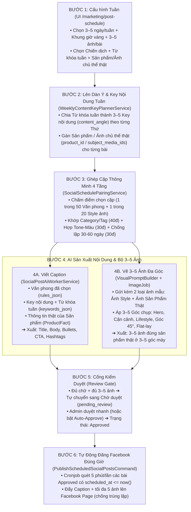
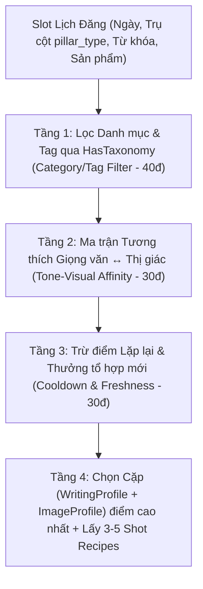
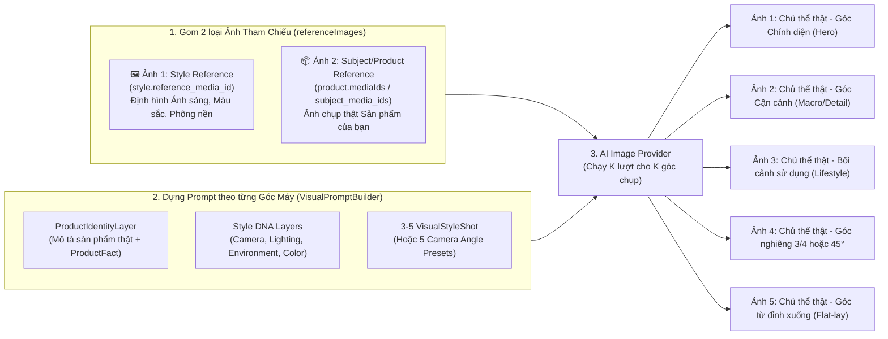

# Kế hoạch Lịch Đăng Bài Tự Động Hàng Tuần (3–5 Bài Facebook/Tuần × 3–5 Ảnh/Bài)

**Cập nhật:** 27/10/2026  
**Trạng thái:** APPROVED DESIGN — Tài liệu thiết kế kiến trúc & lộ trình triển khai 4 Trục (Từ khóa/Key nội dung + Ảnh chủ thể thật + Văn phong AI + Phong cách/Góc chụp ảnh).  
**Phạm vi:** Kết nối hệ thống **Lập kế hoạch Từ khóa & Key nội dung tuần (`WeeklyContentKeyPlanner`)**, **Chủ thể/Sản phẩm thật (`Product` / `Subject Reference Media`)**, **Văn phong AI (`AiWritingProfile` - ~50 mẫu)**, **Phong cách ảnh (`AiImageProfile` / `VisualStyle` - ~20 mẫu)** và **Social Post Scheduler (`/marketing/post-schedule`)** để mỗi tuần tự động sinh **3–5 bài viết Facebook hoàn chỉnh (Content chuẩn SEO/từ khóa + 3–5 ảnh đa góc chụp giữ nguyên chủ thể thật)** và đăng theo khung giờ vàng.

---

## 1. Mục tiêu cốt lõi & "4 Mảnh Ghép" của mỗi bài đăng

### 1.1. Bốn nguyên liệu cấu thành mỗi bài viết
Để AI tự động tạo ra 3–5 bài/tuần × 3–5 ảnh/bài đạt chất lượng thương mại thực tế (không lặp ý, không bịa đặt sai sản phẩm, không lệch tông), mỗi bài đăng được lắp ghép từ **4 trụ cột cốt lõi**:

| Trụ cột | Vai trò trong bài đăng | Nguồn dữ liệu trong hệ thống |
| :--- | :--- | :--- |
| **1. Từ khóa & Key Nội dung (`Keywords & Content Key`)** | **Viết về cái gì:** Xác định chủ đề, góc tiếp cận (`content_angle`) theo từng Thứ trong tuần và bộ từ khóa/hashtag trọng tâm (`keywords_json`). | `WeeklyContentKeyPlannerService` sinh từ Từ khóa tuần của Admin + `Campaign` (`objective`, `message`). |
| **2. Chủ thể thật & Ảnh gốc (`Subject / Product Reference`)** | **Vẽ cái gì & Thông tin thật nào:** Khóa cứng hình dáng, bao bì, tem nhãn của sản phẩm thật xuyên suốt 3–5 bức ảnh và cung cấp thông số thật (`ProductFact`). | Chọn từ bảng `Product` (`product_id` kèm `HasMediaAssets` & `ProductFact`) hoặc chọn trực tiếp 1–3 ảnh thật từ Media Library (`subject_media_ids` + `subject_description`). |
| **3. Văn phong AI (`Writing Profile`)** | **Viết giọng gì:** Quy định cách xưng hô, nhịp câu, cảm xúc, cách mở bài, gạch đầu dòng, kết bài và từ cấm. | Kho ~50 mẫu `AiWritingProfile` (`rules_json`), phân loại qua `HasTaxonomy` (`categories`, `tags`). |
| **4. Phong cách ảnh & Góc chụp (`Visual Style + Shots`)** | **Vẽ như thế nào:** Quy định ánh sáng, mood màu, phông nền (`Style DNA` + `Style Reference`) và **3–5 góc máy khác nhau** cho album ảnh. | Kho ~20 mẫu `AiImageProfile` (`dna_json`, `reference_media_id`) + 3–5 `VisualStyleShot` (hoặc 5 Camera Presets chuẩn). |

### 1.2. Mục tiêu vận hành
1. **Tần suất chuẩn cho Fanpage:** Tự động lên dàn ý, tạo nháp và hẹn giờ đăng **3–5 bài viết Facebook/tuần** vào các khung giờ vàng.
2. **Định dạng mỗi bài đăng:**
   - **Content:** Đầy đủ cấu trúc `FacebookContent` (`title`, `body`, `bullet_points`, `cta`, `contact`, `hashtags`) bám sát **Key nội dung của ngày hôm đó**, phủ đúng **Từ khóa tuần**, đúng thông tin thật của **Sản phẩm** và đúng **Văn phong** đã chọn.
   - **Hình ảnh:** Bộ gallery **3–5 ảnh/bài** (`aspect_ratio = 4:5` hoặc `1:1`) giữ nguyên **hình dáng Chủ thể/Sản phẩm thật**, đồng nhất về màu sắc/ánh sáng (**Style DNA**) nhưng **khác nhau về góc chụp (Shot Recipes)** để tạo thành album kể chuyện (storytelling lookbook).
3. **Khai thác thông minh kho 50 Văn phong × 20 Phong cách ảnh (1.000 tổ hợp):**
   - Không ghép ngẫu nhiên gây lệch tông (ví dụ: văn phong học thuật đi với ảnh hoạt hình).
   - Không lặp lại nhàm chán cùng một giọng văn hay một màu ảnh liên tiếp trên bảng tin Fanpage.
4. **Khép kín luồng từ UI đến Facebook Graph API:**
   - Cấu hình tại `/marketing/post-schedule` ➔ Lên dàn ý Từ khóa & Key nội dung tuần ➔ Ghép cặp Văn phong + Style ảnh ➔ AI viết bài & vẽ 3–5 góc ảnh từ ảnh chủ thể thật ➔ Hàng chờ duyệt (`Review Gate`) ➔ Tự động đăng lên Facebook Page khi đến giờ `scheduled_at`.

---

## 2. Sơ đồ tổng thể Luồng Tự Động Hóa 6 Bước (End-to-End Workflow)

---

## 3. Đối chiếu hiện trạng Codebase (4 luồng hiện có & Khoảng trống cần nối)

| Luồng hệ thống | Các file / Service cốt lõi đã có | Trạng thái hiện tại | Khoảng trống cần nối / nâng cấp |
| :--- | :--- | :--- | :--- |
| **1. Luồng Từ khóa, Chiến dịch & Chủ thể thật (`Campaign` / `Product`)** | • `app/Models/Campaign.php` • `app/Models/Product.php` (đã có `HasMediaAssets` & `facts()`) • `app/Models/ProductFact.php` • `app/Services/Ai/VisualStyle/PromptLayers/ProductContext.php` • `app/Services/Ai/VisualStyle/PromptLayers/ProductIdentityLayer.php` • `app/Services/Marketing/SocialPostContextBuilder.php` | • `Campaign` đã có quan hệ nhiều-nhiều với `Product` (`campaign_products`). • `Product` đã lưu ảnh chụp thật (`HasMediaAssets`) và các thông tin xác thực (`ProductFact`). • `ProductContext` đã hỗ trợ lấy chủ thể từ cả `Product` model lẫn ảnh upload rời (`fromUpload`). | • **Đang bị ngắt kết nối ở Social Post:** `SocialPostContextBuilder` hiện chỉ đọc mỗi `Campaign.message` chung chung, **chưa đọc `Product`, `ProductFact`, ảnh chủ thể thật**, và chưa có cơ chế chia **Từ khóa tuần thành 3–5 Key nội dung (`content_angle`)** cho các ngày trong tuần. |
| **2. Luồng Prompt ảnh, Ảnh tham chiếu kép & Đa góc chụp** | • `app/Models/AiImageProfile.php` (đã có `HasTaxonomy`) • `app/Models/VisualStyleShot.php` • `app/Services/Ai/VisualStyle/VisualPromptBuilder.php` • `app/Services/Ai/VisualStyle/VisualStyleGenerationService.php` • `app/Services/Ai/Images/AiImageGenerationService.php` • `app/Jobs/ProcessSocialPostImageJob.php` | • Bên `VisualStyleGenerationService::referenceImages()` **đã hỗ trợ gom cả 2 loại ảnh tham chiếu** gửi xuống AI cùng lúc:   1. **Ảnh 1 (`Style Reference`):** `style.reference_media_id` (định hình ánh sáng, màu sắc, bố cục).   2. **Ảnh 2 (`Subject/Product Reference`):** `product.mediaIds` (ảnh chụp thật sản phẩm để khóa hình dáng chủ thể). • Mỗi style đã có 3–5 `VisualStyleShot` (góc chụp khác nhau). | • Bên luồng Social Post (`SocialPostAiWorkerService::processImagePrompt` & `ProcessSocialPostImageJob`), code hiện mới chỉ nối chuỗi `"Variation slot 1..N"` và khi gọi `$images->generate(...)` **đang bỏ trống tham số `$referenceImages`**. • Cần bê cơ chế `VisualPromptBuilder` + `VisualStyleShot` + `referenceImages(Style + Subject)` sang luồng tạo ảnh Social Post. |
| **3. Luồng Văn phong (`Writing Profile`)** | • `app/Models/AiWritingProfile.php` • `app/Models/Concerns/HasTaxonomy.php` • `app/Services/Ai/WritingProfiles/WritingProfileService.php` • `app/Services/Ai/WritingProfiles/WritingProfileSnapshotService.php` | • Hỗ trợ tạo từ bài mẫu (`reference`) hoặc thủ công (`manual`). • Có `rules_json` (`tone`, `pronouns`, `emotion`, `opening`, `sentence_rhythm`, `bullets`, `ending`, `avoid`). • Đã có trait `HasTaxonomy` dùng chung cho toàn hệ thống. | • Gắn trait `HasTaxonomy` (`categories()`, `tags()`) vào `AiWritingProfile` để phân nhóm văn phong (*Hài hước, Chuyên nghiệp, Thân thiện, Bán hàng, Kiến thức, Truyền cảm hứng*) đồng bộ với `AiImageProfile`. |
| **4. Luồng Social Post & Lịch đăng** | • `app/Models/SocialPost.php` (`scheduled_at`) • `app/Models/DailyContentPlan.php` • `app/Services/Marketing/SocialPostGenerationService.php` • `app/Services/Marketing/SocialPostGenerationStateService.php` • `app/Services/Marketing/Publishing/FacebookPublisher.php` • `app/Console/Commands/GenerateDailySocialPostDraftsCommand.php` • UI: `resources/js/pages/marketing/post-schedule/index.vue` & 6 tabs | • Đã có pipeline tạo Caption + Gallery ảnh, kiểm duyệt (`MIN_GALLERY_IMAGES = 3`) và đăng Facebook chống trùng (`idempotency_key`). • Đã có giao diện 6 tab tại `/marketing/post-schedule`. | • `GenerateDailySocialPostDraftsCommand` đang chạy cố định 2–3 bài/ngày, chưa chạy theo lịch tuần (3–5 bài/tuần) và chưa truyền Key nội dung, Chủ thể thật, Văn phong, Style ảnh, Số ảnh (3–5), Giờ hẹn đăng. • `FacebookPublisher.php` (dòng 68) đang cắt `array_slice($images, 0, 4)` — cần nâng lên `5` ảnh. • Chưa có command định kỳ quét `scheduled_at <= now()` để tự động publish các bài đã `approved`. • UI `/marketing/post-schedule` đang dùng dữ liệu mẫu tĩnh, chưa nối API. |

---

## 4. Kế hoạch Lên Từ Khóa Tuần & Triển Khai 3–5 Key Nội Dung (`WeeklyContentKeyPlannerService`)

### 4.1. Nguồn Từ khóa & Chủ thể đầu tuần (2 chế độ linh hoạt)
1. **Chế độ Chủ động (Admin định hướng đầu tuần):**
   - Admin nhập nhanh **Chủ đề tuần + 3–5 từ khóa trọng tâm** (VD: *`"Cold Brew cam sả", "tỉnh táo đầu tuần", "ủ lạnh 16 tiếng", "mua 2 tặng 1"`*).
   - Chọn **Sản phẩm chủ đạo (`Product`)** hoặc đính kèm **1–3 ảnh chụp chủ thể thật (`subject_media_ids`)** từ Media Library.
2. **Chế độ Tự động 100% (AI tự lập kế hoạch từ Campaign):**
   - Nếu Admin không nhập tay, `WeeklyContentKeyPlannerService` tự đọc `Campaign` (`objective`, `message`), lấy danh sách các `Product` thuộc `Campaign` (kèm ảnh thật của từng sản phẩm) và đối chiếu lịch sử 4 tuần gần nhất để tự sinh bộ từ khóa & phân bổ sản phẩm cho tuần mới không trùng lặp.

### 4.2. Khung Lịch Tuần (3–5 bài/tuần) & Cách triển khai Key Nội dung + Chủ thể ảnh

Mỗi tuần hệ thống vận hành **3–5 slot cố định** trải đều theo tâm lý lướt Facebook. Từ khóa tuần sẽ được tách thành **3–5 góc khai thác (`content_angle`)** khác nhau hoàn toàn:

| Slot | Thứ | Giờ đăng (`scheduled_at`) | Trụ cột nội dung (`pillar_type`) | Cách triển khai Từ khóa & Key Nội dung (`content_angle`) | Nhóm Văn phong ưu tiên (`AiWritingProfile`) | Nhóm Phong cách ảnh (`AiImageProfile`) | Số ảnh | Phân vai 3–5 góc chụp trên cùng Chủ thể thật |
| :---: | :--- | :---: | :--- | :--- | :--- | :--- | :---: | :--- |
| **1** | **Thứ 2** | **08:00** | **`inspire`** *(Khởi động tuần mới / Đời sống)* | Gắn từ khóa tuần với năng lượng tích cực sáng đầu tuần và cảm hứng trải nghiệm sản phẩm trong đời sống. | **Hài hước** hoặc **Truyền cảm hứng** *(Câu ngắn, dí dỏm, tươi mới)* | **Photorealistic / Lifestyle** *(Ánh sáng ban mai tự nhiên, ấm áp)* | **3–4 ảnh** | • **Slot 1:** Chủ thể thật trong không gian buổi sáng (Hero) • **Slot 2:** Cận cảnh (Close-up) chi tiết chủ thể thật • **Slot 3–4:** Góc Lifestyle sử dụng tự nhiên |
| **2** | **Thứ 4** | **12:00** | **`knowledge`** *(Chia sẻ kiến thức / Tips)* | Khai thác từ khóa tuần dưới dạng mẹo hữu ích, giải thích công dụng/thành phần dựa trên `ProductFact` xác thực. | **Chia sẻ kiến thức** hoặc **Chuyên nghiệp** *(Rõ ràng, chia bước, có bullet points)* | **Minimal / Studio Clean** *(Bố cục tối giản, nhiều khoảng trống, tập trung)* | **4 ảnh** | • **Slot 1:** Chủ thể thật chính diện rõ nét (Hook) • **Slot 2:** Cận cảnh thành phần / chi tiết kỹ thuật 1 • **Slot 3:** Cận cảnh chất liệu / chi tiết kỹ thuật 2 • **Slot 4:** Bố cục tổng kết gọn gàng |
| **3** *(Tùy chọn)* | **Thứ 5** | **19:30** | **`story`** *(Câu chuyện / Hậu trường)* | Khai thác từ khóa qua câu chuyện hậu trường, sự tỉ mỉ trong quy trình/chất liệu hoặc trải nghiệm khách hàng. | **Thân thiện / Kể chuyện** *(Tâm sự nhẹ nhàng, gần gũi, tạo đồng cảm)* | **Cinematic / Warm Tone** *(Ánh sáng chiều tối, màu phim có chiều sâu)* | **3–4 ảnh** | • **Slot 1:** Góc rộng bối cảnh có chủ thể thật • **Slot 2:** Khoảnh khắc tương tác với chủ thể thật (Medium) • **Slot 3–4:** Đặc tả cảm xúc/chất liệu (Macro) |
| **4** | **Thứ 6** | **17:30** | **`sales`** *(Bán hàng / Sản phẩm chủ lực)* | Tập trung trực diện vào từ khóa mua hàng, lợi ích nổi bật của sản phẩm, ưu đãi cuối tuần và CTA chốt đơn rõ ràng. | **Bán hàng (Sales)** *(Nêu bật lợi ích ngay dòng đầu, có ưu đãi & CTA)* | **Commercial Product / Studio** *(Sắc nét, ánh sáng studio tôn sản phẩm)* | **5 ảnh** | • **Slot 1:** Hero shot chính diện sản phẩm thật • **Slot 2:** Góc nghiêng 3/4 tôn hình khối sản phẩm thật • **Slot 3:** Cận cảnh (Macro) tem nhãn/chất liệu thật • **Slot 4:** Sản phẩm thật trong bối cảnh sử dụng • **Slot 5:** Flat-lay tổng thể thúc đẩy chốt đơn |
| **5** | **Chủ Nhật** | **09:00** *(hoặc 20:00)* | **`engagement`** *(Tương tác cuối tuần / Minigame)* | Biến từ khóa tuần thành câu hỏi thảo luận vui, so sánh thú vị hoặc minigame nhẹ nhàng kích thích bình luận. | **Hài hước / Thân thiện** *(Vui vẻ, đặt câu hỏi mở kích thích comment)* | **Vivid / Lifestyle / Creative** *(Màu sắc tươi sáng, bắt mắt khi lướt feed nghỉ ngơi)* | **3–4 ảnh** | • **Slot 1:** Chủ thể thật ở góc nhìn bắt mắt gây tò mò • **Slot 2–3:** Các góc nhìn / tình huống thú vị • **Slot 4:** Bối cảnh thư giãn cuối tuần |

> [!TIP]
> **Quy tắc chọn ngày theo tần suất tuần:**
> - Nếu chọn **3 bài/tuần**: Chạy **Thứ 2 – Thứ 4 – Thứ 6**.
> - Nếu chọn **4 bài/tuần**: Chạy **Thứ 2 – Thứ 4 – Thứ 6 – Chủ Nhật**.
> - Nếu chọn **5 bài/tuần**: Chạy đủ **Thứ 2 – Thứ 4 – Thứ 5 – Thứ 6 – Chủ Nhật**.

---

## 5. Thuật toán Ghép cặp 4 Tầng (50 Văn phong × 20 Phong cách ảnh)

Khi kho dữ liệu có tới **50 `AiWritingProfile`** và **20 `AiImageProfile`** ($50 \times 20 = 1.000$ tổ hợp), hệ thống sử dụng **`SocialSchedulePairingService`** để chấm điểm và chọn cặp tự động theo 4 tầng:

### Tầng 1: Đồng bộ theo Danh mục / Tag chủ đề (Trọng số: 40 điểm)
- Sử dụng trait `HasTaxonomy` (`categories`, `tags`) cho cả `AiWritingProfile` và `AiImageProfile`.
- Nếu Slot lịch đăng có `pillar_type` hoặc danh mục (ví dụ: `Khuyến mãi / Bán hàng` hoặc `Chia sẻ kiến thức`), hệ thống cộng **+40 điểm** cho các Văn phong và Style ảnh có trùng `category` hoặc `tag` với Slot/Campaign đó.

### Tầng 2: Ma trận Tương thích Giọng văn ↔ Thị giác (Trọng số: 30 điểm)
So khớp tự động giữa `AiWritingProfile.rules_json` (`tone`, `emotion`, `sentence_rhythm`) và `AiImageProfile.dna_json` (`color_mood`, `lighting`, `camera`, `environment`):

| Đặc trưng Văn phong (`rules_json`) | Đặc trưng Style DNA tương thích (+30đ) | Đặc trưng Style DNA xung đột (-30đ / Loại) |
| :--- | :--- | :--- |
| **Hài hước / Bắt trend / Sôi nổi** | `color_mood.saturation` $\in$ `[vivid, high]`, `lighting.intensity` $\in$ `[medium, high]`, hoặc nhóm `Creative / Lifestyle` | `color_mood.saturation = desaturated`, `lighting.type = dramatic` u tối |
| **Chuyên nghiệp / Chia sẻ kiến thức** | `composition.negative_space` $\in$ `[moderate, dominant]`, `visual_balance = symmetric`, `environment.type` $\in$ `[studio_solid, studio_gradient]` | Bố cục lộn xộn, góc máy `dutch` nghiêng ngả |
| **Thân thiện / Kể chuyện / Truyền cảm hứng** | `lighting.temperature = warm`, `lighting.type` $\in$ `[golden_hour, natural_window]`, `environment.type` $\in$ `[lifestyle_interior, lifestyle_exterior]` | Ánh sáng `cool` lạnh lẽo, `hard shadows` gắt |
| **Bán hàng (Sales) / Giới thiệu sản phẩm** | `style_constraints.commercial_quality = true`, `camera.shot_type` $\in$ `[hero, product_single, detail]`, `camera.focus = sharp_all` | Ảnh `soft focus` mờ ảo, `extreme_wide` chủ thể quá nhỏ |

### Tầng 3: Chống lặp & Phân bổ đều kho 50 × 20 (Trọng số: 30 điểm)
Truy vấn lịch sử `SocialPostVersion` và `DailyContentPlan` trong **30–60 ngày gần nhất**:
1. **Cooldown Văn phong (Writing Profile Cooldown):**
   - Với 50 văn phong, một văn phong vừa được sử dụng sẽ bị phạt điểm trong **10 bài tiếp theo** (đảm bảo ít nhất 2–3 tuần không lặp lại cùng 1 văn phong).
2. **Cooldown Phong cách ảnh (Image Style Cooldown):**
   - Với 20 style ảnh, **cấm tuyệt đối** dùng cùng 1 `image_profile_id` cho 2 bài liên tiếp. Mỗi bài trong cùng 1 tuần bắt buộc có `image_profile_id` khác nhau.
3. **Điểm thưởng Tổ hợp mới (Pair Exploration Bonus):**
   - Cặp `(writing_profile_id, image_profile_id)` nào chưa từng kết hợp với nhau trong 60 ngày qua được cộng **+15 điểm**; cặp nào vừa kết hợp trong 30 ngày qua bị trừ **-20 điểm**.

### Tầng 4: 3 Chế độ vận hành cho Admin trên UI
1. **`auto_smart` (Mặc định):** Tự động chạy thuật toán 3 tầng trên để chọn cặp tốt nhất cho từng ngày.
2. **`rule_by_day` (Theo nhóm từng thứ):** Admin chọn nhóm Văn phong + nhóm Style ảnh cho từng Thứ (ví dụ Thứ 2 = *Hài hước + Lifestyle*, Thứ 6 = *Bán hàng + Studio Product*), hệ thống tự xoay vòng các mẫu trong nhóm đó.
3. **`pinned` (Ghim cố định):** Admin chỉ định đích danh `writing_profile_id` và `image_profile_id` cho một slot cụ thể.

---

## 6. Cơ chế Gửi "2 Loại Ảnh Tham Chiếu" & Sinh 3–5 Ảnh Đa Góc Chụp

Khi tạo bộ $K \in [3, 5]$ bức ảnh cho 1 bài viết, hệ thống kết hợp **Ảnh tham chiếu kép (`Dual Reference Images`)** + **Lớp nhận diện chủ thể (`ProductIdentityLayer`)** + **Công thức góc chụp (`Shot Recipes`)**:

### 6.1. Cơ chế gom 2 loại ảnh tham chiếu (`referenceImages`)
Mọi lượt gọi `$images->generate(...)` cho cả $K$ bức ảnh trong bài đều nhận chung mảng `$referenceImages` gồm:
1. **Ảnh 1 — `Style Reference` (`AiImageProfile.reference_media_id`):** Giúp AI học cách đánh sáng, tông màu, chất liệu nền và độ xóa phông của phong cách đã chọn.
2. **Ảnh 2 — `Subject / Product Reference` (Từ `Product` media hoặc `subject_media_ids`):** Là 1–3 tấm ảnh chụp thật sản phẩm của bạn. Giúp AI **khóa cứng nhận diện chủ thể** (giữ đúng hình dáng chai/hộp, bao bì, màu sắc thật, tỷ lệ kích thước) xuyên suốt cả 3–5 tấm ảnh trong cùng bài viết.

### 6.2. Cơ chế đổi góc máy cho 3–5 bức ảnh trong bài
1. **Trường hợp Style ảnh đã có các `VisualStyleShot` (`shots` active $\ge K$):**
   - Lấy $K$ `VisualStyleShot` theo `sort_order`.
   - Với mỗi slot $i \in \{1..K\}$, dùng `VisualPromptBuilder` kết hợp `ProductContext` (chủ thể thật) + `Style DNA` + `Shot Recipe #i` + `$referenceImages` để sinh ảnh.
2. **Trường hợp Style ảnh chưa có đủ `VisualStyleShot` (hoặc dùng thêm cho đủ 5 ảnh):**
   - Hệ thống tự động áp dụng **Bộ 5 Khuôn Góc Chụp Chuẩn (Standard Multi-Shot Presets)** cho từng slot thay vì chỉ ghi `"Variation slot X"`:
     - **Slot 1 (Hero Shot):** `Hero front/three-quarter view, clear focal subject preserving exact product identity from reference image, balanced composition, inviting atmosphere.`
     - **Slot 2 (Detail / Close-up):** `Close-up macro/detail shot of the exact same subject highlighting texture, packaging details, and craftsmanship, shallow depth of field.`
     - **Slot 3 (Lifestyle / Context):** `Medium-wide lifestyle shot placing the exact same product in a natural real-world usage setting, warm and relatable context.`
     - **Slot 4 (Angle Variation):** `Dynamic 45-degree or three-quarter perspective of the exact same subject showing depth, form, and surrounding complementary props.`
     - **Slot 5 (Flat-lay / Overview):** `Top-down flat-lay or curated overview composition featuring the exact same subject with harmonious negative space.`

---

## 7. Các hạng mục kỹ thuật cần triển khai (Implementation Tasks)

### Phase 1: Mở rộng Schema, Taxonomy & Cấu hình Lịch tuần (Backend Foundation)
- [ ] **Task 1.1:** Bổ sung các cột điều phối 4 Trục cho bảng `daily_content_plans` (migration mới):
  - **Trục Từ khóa & Key nội dung:**
    - `pillar_type` (`string nullable` — `inspire`, `knowledge`, `story`, `sales`, `engagement`)
    - `topic_title` (`string nullable` — tiêu đề/chủ đề cụ thể của bài hôm đó)
    - `keywords_json` (`json nullable` — danh sách từ khóa trọng tâm & hashtags của bài)
    - `content_angle` (`text nullable` — dàn ý / key nội dung hướng dẫn AI viết bài)
  - **Trục Chủ thể thật (`Product` đã có `product_id`, bổ sung thêm trường chọn ảnh trực tiếp):**
    - `subject_media_ids` (`json nullable` — mảng ID `media_assets` chụp chủ thể thật nếu chọn trực tiếp)
    - `subject_description` (`text nullable` — mô tả nhận diện chủ thể thật khi không dùng `Product` cố định)
  - **Trục Văn phong, Style ảnh & Lịch hẹn:**
    - `writing_profile_id` (`nullable`, FK ➔ `ai_writing_profiles.id`)
    - `image_profile_id` (`nullable`, FK ➔ `ai_image_profiles.id`)
    - `image_count` (`unsignedTinyInteger`, default `4` — từ 3 đến 5 ảnh/bài)
    - `scheduled_at` (`timestamp nullable` — thời điểm dự kiến đăng bài lên Facebook)
    - `pairing_mode` (`string`, default `'auto_smart'`)
- [ ] **Task 1.2:** Gắn trait `HasTaxonomy` (`app/Models/Concerns/HasTaxonomy.php`) vào `AiWritingProfile` để đồng bộ hệ thống `categories()` và `tags()` với `AiImageProfile`.
- [ ] **Task 1.3:** Định nghĩa cấu trúc lưu cài đặt Lịch đăng tuần trong `Settings` (group `marketing_schedule`):
  - `weekly_target_count`: `3..5` (bài/tuần)
  - `default_image_count`: `3..5` (ảnh/bài)
  - `weekly_seed_keywords`: mảng từ khóa trọng tâm của tuần hiện tại
  - `default_subject_media_ids` & `default_subject_description`: ảnh chủ thể mặc định của tuần (nếu có)
  - `active_weekdays`: mảng cấu hình theo thứ (`mon`, `wed`, `thu`, `fri`, `sun`), mỗi thứ có `time_slot` (`08:00`, `12:00`...), `pillar_type`, `image_count`, `product_id` (nullable), `writing_profile_id` (nullable), `image_profile_id` (nullable).
  - `auto_submit_review`: `boolean` (tự động chuyển sang `pending_review` khi AI tạo xong).
  - `auto_approve`: `boolean` (tùy chọn tự động duyệt `approved` cho chế độ Full Auto-Pilot).
  - `auto_schedule_publish`: `boolean` (tự động đăng theo `scheduled_at` sau khi `approved`).

### Phase 2: Xây dựng Engine Lên Key Nội Dung, Ghép Cặp & Sinh 3–5 Ảnh Chủ Thể Thật
- [ ] **Task 2.1:** Tạo service `App\Services\Marketing\WeeklyContentKeyPlannerService`:
  - Nhận `Campaign` + `weekly_seed_keywords` + danh sách `Product` (hoặc `subject_media_ids`) + các ngày hoạt động trong tuần (`3–5 slots`).
  - Tự động phân bổ sản phẩm/chủ thể thật và sinh ra bộ `(pillar_type, topic_title, keywords_json, content_angle, subject_description)` cho từng bài trong tuần, đảm bảo 3–5 bài trong tuần có góc tiếp cận khác biệt và không trùng lặp với 4 tuần trước.
- [ ] **Task 2.2:** Tạo service `App\Services\Marketing\SocialSchedulePairingService`:
  - Thực thi thuật toán 4 tầng (Taxonomy match 40đ + Tone-to-DNA affinity 30đ + Cooldown 30–60 ngày 30đ) để chọn cặp `(AiWritingProfile, AiImageProfile)` tối ưu cho mỗi slot.
- [ ] **Task 2.3:** Nâng cấp `SocialPostContextBuilder`, `SocialPostAiWorkerService` & `ProcessSocialPostImageJob`:
  - Trong `SocialPostContextBuilder`: Truyền đầy đủ `topic_title`, `keywords_json`, `content_angle` và thông tin `Product` (`name`, `short_description`, `facts` có `is_allowed_for_ai = true`) hoặc `subject_description` vào context viết bài và vẽ ảnh.
  - Trong `SocialPostAiWorkerService::processImagePrompt`: Tích hợp `VisualPromptBuilder`, `ProductContext` (`ProductIdentityLayer`) và `VisualStyleShot` (hoặc 5 Camera Angle Presets) để mỗi slot ảnh (`slot_no = 0..4`) có một prompt góc chụp riêng biệt nhưng khóa cứng cùng một chủ thể thật và Style DNA.
  - Trong `ProcessSocialPostImageJob`: Gom cả **Ảnh 1 (`style.reference_media_id`)** và **Ảnh 2 (`product` media / `subject_media_ids`)** qua helper `referenceImages()` và truyền vào tham số thứ 7 của `$images->generate(..., $referenceImages)`.
- [ ] **Task 2.4:** Cập nhật `FacebookPublisher.php`:
  - Nâng giới hạn upload ảnh từ `array_slice($images, 0, 4)` lên `array_slice($images, 0, 5)`.

### Phase 3: Tự động hóa Scheduler (Lên kế hoạch Tuần, Tạo nháp & Đăng bài đúng giờ)
- [ ] **Task 3.1:** Nâng cấp `GenerateDailySocialPostDraftsCommand` (`marketing:social-post-drafts`):
  - Đọc cấu hình `marketing_schedule` để khởi tạo các slot `DailyContentPlan` trong tuần (nếu chưa có) thông qua `WeeklyContentKeyPlannerService` và `SocialSchedulePairingService`.
  - Với các slot của ngày cần tạo nháp: Tạo `SocialPost` kèm `scheduled_at` đúng khung giờ vàng, lưu `image_count` (3–5) vào `SocialPostVariant`, và xếp hàng `SocialPostGenerationService::queue()`.
- [ ] **Task 3.2:** Hỗ trợ `auto_submit_review` & `auto_approve` trong `SocialPostGenerationStateService::refresh()`:
  - Khi cả Caption và đủ `image_count` (3–5 ảnh) chuyển sang `ready`, tự động chuyển `review_status` sang `pending_review` (hoặc `approved` nếu bật `auto_approve`).
- [ ] **Task 3.3:** Tạo command mới `PublishScheduledSocialPostsCommand` (`marketing:publish-scheduled-posts`) và đăng ký vào `ProjectScheduleRegistry`:
  - Chạy định kỳ mỗi 5 phút (`everyFiveMinutes()`), tìm các `SocialPost` có `review_status = approved`, `publication_status = pending`, `generation_status = ready` và `scheduled_at <= now()`, gọi `SocialPublicationService::queue()` để đăng lên Facebook Page.

### Phase 4: Kết nối API cho giao diện `/marketing/post-schedule`
- [ ] **Task 4.1:** Tạo `PostScheduleController` (trong nhóm Admin Marketing API) cung cấp các endpoint:
  - `GET /api/admin/marketing/post-schedule/overview`: KPI thống kê thực tế, cấu hình `marketing_schedule` hiện tại, danh sách lịch bài đăng & dàn ý từ khóa trong tuần.
  - `PUT /api/admin/marketing/post-schedule/settings`: Lưu cấu hình lịch tuần (3–5 bài/tuần, 3–5 ảnh/bài, từ khóa tuần, sản phẩm/ảnh chủ thể, công tắc tự động).
  - `POST /api/admin/marketing/post-schedule/generate-weekly-plan`: Bấm 1 nút để AI lập ngay dàn ý **Từ khóa + Key nội dung + Ghép cặp Văn phong/Style ảnh + Chủ thể thật** cho 3–5 bài trong tuần.
  - `PUT /api/admin/marketing/post-schedule/plans/{plan}`: Cho phép Admin sửa nhanh Từ khóa, Key nội dung, Ảnh chủ thể thật, Văn phong hoặc Style ảnh của từng slot trên lịch trước khi chạy tạo bài.
- [ ] **Task 4.2:** Nối dữ liệu thật từ API vào 6 tab trong `resources/js/views/marketing/post-schedule/`:
  - `GeneralTab.vue`: Cấu hình 3–5 bài/tuần, 3–5 ảnh/bài, nhập **Từ khóa trọng tâm của tuần**, chọn **Chiến dịch & Sản phẩm/Ảnh chủ thể thật**, công tắc tự động gửi duyệt & tự động đăng.
  - `ScheduleTab.vue`: Hiển thị các slot tuần trên lưới lịch kèm **Tiêu đề Key nội dung, Từ khóa, Ảnh chủ thể thật, Văn phong & Style ảnh**, cho phép bấm tạo dàn ý tuần hoặc sửa nhanh từng slot.
  - `ToneTab.vue`: Đồng bộ danh sách với `AiWritingProfile` (50 mẫu văn phong), hỗ trợ lọc/gắn nhóm chủ đề (`HasTaxonomy`).
  - `ImageStyleTab.vue`: Đồng bộ danh sách với `AiImageProfile` (20 style ảnh), hiển thị ảnh mẫu Style + số lượng Shot Recipes.
  - `PlatformsTab.vue` & `AdvancedTab.vue`: Cấu hình quota nền tảng và quy tắc Cooldown / Ghép cặp tự động.
