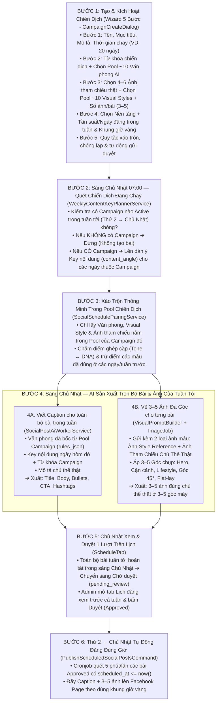

# Kế hoạch Lịch Đăng Bài Tự Động Theo Chiến Dịch (Campaign-Driven Weekly Schedule & Batch Generation)

**Cập nhật:** 27/10/2026  
**Trạng thái:** APPROVED DESIGN — Kiến trúc **Lấy Chiến Dịch làm trung tâm (Campaign-Driven)** kết hợp **Cuốn chiếu Sáng Chủ Nhật hàng tuần (Weekly Rolling Batch)** và **4 Trục Nội dung** (Từ khóa chiến dịch + Ảnh chủ thể tham chiếu + Pool Văn phong AI + Pool Phong cách/Góc chụp ảnh).  
**Phạm vi:** Kết nối hệ thống **Chiến dịch (`Campaign` & Wizard 5 bước)**, **Kho Văn phong AI (`AiWritingProfile` - ~50 mẫu)**, **Kho Phong cách ảnh (`AiImageProfile` / `VisualStyle` - ~20 mẫu)**, **Thư viện Ảnh tham chiếu chủ thể (`MediaAsset`)** và **Social Post Scheduler (`/marketing/post-schedule`)**. Hệ thống **chỉ tự động lên dàn ý & sinh bài viết khi có Chiến dịch đang chạy (`Active`)**, phân bổ thông minh xuyên suốt thời lượng chiến dịch (VD: 15–30 ngày) và soạn sẵn trọn bộ bài mỗi tuần vào **sáng Chủ Nhật (`07:00`)** để Admin duyệt 1 lượt.

---

## 1. Triết lý Vận hành Cốt lõi: "Lấy Chiến Dịch Làm Trung Tâm" (Campaign-Driven)

### 1.1. Nguyên tắc hoạt động
1. **Không có Chiến dịch = Không tự sinh bài rác:**
   - AI **chỉ hoạt động** khi có ít nhất 1 `Campaign` ở trạng thái **`Đang chạy (active)`** nằm trong khoảng thời gian hiệu lực (`starts_at <= ngày_đăng <= ends_at`).
   - Nếu trong khoảng thời gian hiện tại không có chiến dịch nào chạy (hoặc tất cả chiến dịch đã kết thúc / tạm dừng), hệ thống **đứng yên 100%**, không tốn token hay chi phí sinh ảnh AI.
2. **Mọi nguyên liệu tạo bài được đóng gói trọn vẹn trong Chiến Dịch (`CampaignCreateDialog` — 5 bước):**
   - Thay vì cấu hình rời rạc ở nhiều nơi, khi tạo một Chiến dịch (ví dụ kéo dài **20 ngày**), Admin quy định toàn bộ nguyên liệu ngay trong Dialog Chiến dịch:
     - **Thời lượng & Mục tiêu:** Ngày bắt đầu – kết thúc (`starts_at` – `ends_at`), mục tiêu (`product`, `sales`, `branding`, `engagement`...), thông điệp cốt lõi.
     - **Từ khóa & Key nội dung (`Campaign Keywords`):** Bộ từ khóa trọng tâm và các chủ đề/hashtag xuyên suốt chiến dịch.
     - **Pool Văn phong AI (`Selected Writing Profiles`):** Chọn ra khoảng **6–10 văn phong** phù hợp với chiến dịch từ kho 50 mẫu `AiWritingProfile`.
     - **Pool Phong cách ảnh (`Selected Visual Styles`) & Ảnh tham chiếu chủ thể (`Subject Reference Media`):** Chọn ra **6–10 Visual Styles** từ kho 20 mẫu `AiImageProfile`, kèm **4–6 ảnh chụp thật sản phẩm/chủ thể** từ Media Library để AI xáo trộn trong phạm vi cho phép.
     - **Tần suất & Lịch đăng (`Campaign Schedule`):** Quy định số bài/ngày hoặc các Thứ đăng bài trong tuần + khung giờ vàng + số ảnh/bài (`3–5 ảnh/bài`).
3. **Cơ chế "Cuốn chiếu Sáng Chủ Nhật (`07:00`) — Duyệt 1 lần cho cả tuần":**
   - Với một chiến dịch kéo dài nhiều ngày (VD: 20 ngày, vắt qua 3 tuần):
     - **Tuần đầu tiên (khi vừa kích hoạt Chiến dịch giữa tuần):** Cho phép bấm tạo ngay các bài của những ngày còn lại trong tuần hiện tại.
     - **Các tuần tiếp theo (07:00 sáng Chủ Nhật hàng tuần):** Hệ thống tự động kiểm tra các ngày từ **Thứ 2 → Chủ Nhật** của tuần tới có nằm trong `starts_at → ends_at` của Chiến dịch không. Nếu có, AI tự động chia mạch nội dung (Story Arc), bốc tổ hợp *(Văn phong + Visual Style + Ảnh tham chiếu)* từ Pool của Chiến dịch (không trùng với tuần trước) và **soạn sẵn trọn bộ bài viết + hình ảnh của cả tuần đó**.
     - Toàn bộ bài tạo xong chuyển sang **`Chờ duyệt (pending_review)`** để Admin mở tab **Lịch đăng** trong ngày Chủ Nhật xem lướt và bấm **Duyệt (`Approve`) 1 lượt**.
     - Từ Thứ 2 đến Chủ Nhật, cronjob tự động đăng các bài đã duyệt lên Fanpage khi đến đúng giờ vàng `scheduled_at`.

### 1.2. "4 Mảnh Ghép" của mỗi bài đăng trong Chiến dịch

| Trụ cột | Vai trò trong bài đăng | Nguồn dữ liệu trong Chiến dịch (`Campaign`) |
| :--- | :--- | :--- |
| **1. Từ khóa & Góc nội dung (`Keywords & Angle`)** | **Viết về cái gì:** Xác định chủ đề bài viết theo tiến độ chiến dịch (Mở đầu ➔ Đi sâu ➔ Chốt đơn) và phủ đúng bộ từ khóa. | `WeeklyContentKeyPlannerService` phân bổ từ `campaign.keywords_json`, `campaign.objective`, `campaign.message` theo từng ngày. |
| **2. Ảnh tham chiếu chủ thể thật (`Subject Reference`)** | **Vẽ cái gì & Khóa nhận diện:** Khóa cứng hình dáng, bao bì, màu sắc thật của sản phẩm/không gian xuyên suốt 3–5 bức ảnh trong bài. | Bốc 1–3 ảnh từ Pool **4–6 ảnh tham chiếu** (`campaign.subject_media_ids` + `subject_description`) đã chọn ở Bước 3 của Chiến dịch. |
| **3. Văn phong AI (`Writing Profile`)** | **Viết giọng gì:** Quy định cách xưng hô, nhịp câu, cảm xúc, mở bài, gạch đầu dòng, CTA và từ cấm. | Bốc 1 mẫu từ Pool **~10 văn phong** (`campaign.writing_profile_ids`) đã chọn ở Bước 2 của Chiến dịch. |
| **4. Phong cách ảnh & Đa góc chụp (`Visual Style + Shots`)** | **Vẽ như thế nào:** Quy định ánh sáng, mood màu, phông nền (`Style DNA` + `Style Reference`) và **3–5 góc máy khác nhau** cho album ảnh. | Bốc 1 mẫu từ Pool **~10 style ảnh** (`campaign.image_profile_ids`) đã chọn ở Bước 3 + 3–5 `VisualStyleShot` (hoặc 5 Camera Presets chuẩn). |

---

## 2. Sơ đồ tổng thể Luồng Tự Động Hóa 6 Bước Theo Chiến Dịch

---

## 3. Phân vai chi tiết giữa 7 Tab trên trang `/marketing/post-schedule`

Để không bị chồng chéo giữa cài đặt hệ thống và cài đặt chiến dịch, 7 tab trên giao diện `/marketing/post-schedule` được phân vai chuẩn như sau:

| Tab / Component | Vai trò trong kiến trúc Campaign-Driven |
| :--- | :--- |
| **1. Tab `Cài đặt chung`** (`GeneralTab.vue`) | **Cấu hình Hệ thống dùng chung (Global System Config):** • Chọn Model AI mặc định cho viết bài (Text LLM) và tạo ảnh (Image Generation Model). • Ngôn ngữ mặc định (`Tiếng Việt`), Múi giờ hệ thống (`Asia/Ho_Chi_Minh`). • Lịch chạy **Batch Sáng Chủ Nhật** toàn cục (`sunday_batch_enabled = true`, `sunday_batch_time = 07:00`). • Công tắc mặc định toàn hệ thống: `Tự động gửi vào hàng chờ duyệt sau khi tạo`, `Tự động đăng khi đến giờ hẹn sau khi duyệt`. |
| **2. Tab `Chiến Dịch`** (`CampaignTab.vue` + `CampaignCreateDialog.vue`) | **Trung tâm điều khiển chiến dịch & tạo bài:** • Danh sách các chiến dịch (`Đang chạy`, `Sắp bắt đầu`, `Tạm dừng`, `Đã hoàn thành`, `Nháp`) kèm thanh tiến độ số bài đã tạo / tổng số bài dự kiến. • **Wizard 5 bước (`CampaignCreateDialog.vue`)** quy định toàn bộ: Thông tin & thời hạn chiến dịch (Bước 1) ➔ Từ khóa & Pool Văn phong (Bước 2) ➔ Ảnh tham chiếu thật & Pool Visual Styles (Bước 3) ➔ Nền tảng, Tần suất & Khung giờ đăng (Bước 4) ➔ Quy tắc xáo trộn/chống lặp của chiến dịch (Bước 5). |
| **3. Tab `Lịch đăng`** (`ScheduleTab.vue`) | **Bảng theo dõi & Duyệt bài hàng tuần:** • Hiển thị lịch bài đăng theo `Tháng / Tuần / Ngày`, lọc theo Chiến dịch & Nền tảng. • Hiển thị rõ các ngày nằm trong vùng hoạt động của Chiến dịch, trạng thái từng bài (`Đang lên dàn ý`, `Chờ duyệt`, `Đã duyệt`, `Đã đăng`). • Cho phép click vào bài trên lịch để xem nhanh **Caption + 3–5 ảnh + Văn phong + Style ảnh**, sửa nhanh hoặc bấm **Duyệt cả tuần** vào ngày Chủ Nhật. |
| **4. Tab `Văn phong AI`** (`ToneTab.vue`) | **Kho thư viện gốc Văn phong (Master Tone Library - ~50 mẫu):** • Nơi quản lý, thêm/sửa/xóa, phân loại danh mục và xem trước toàn bộ kho `AiWritingProfile` của hệ thống. • Cung cấp nguồn dữ liệu để **Bước 2 của Dialog Chiến Dịch** lấy ra cho Admin tick chọn vào Pool của từng chiến dịch. |
| **5. Tab `Phong cách hình ảnh`** (`ImageStyleTab.vue`) | **Kho thư viện gốc Visual Styles (Master Visual Style Library - ~20 mẫu):** • Nơi quản lý, tìm kiếm, lọc danh mục, chỉnh sửa Style DNA / Shot Recipes của toàn bộ kho `AiImageProfile`. • Cung cấp nguồn dữ liệu để **Bước 3 của Dialog Chiến Dịch** lấy ra cho Admin tick chọn vào Pool của từng chiến dịch. |
| **6. Tab `Nền tảng`** (`PlatformsTab.vue`) | **Cấu hình giới hạn & kết nối Nền tảng (Global Platform Guardrails):** • Giới hạn trần (safety cap) số bài đăng tối đa/ngày và số ảnh tối đa/bài trên từng nền tảng (Facebook, Instagram, TikTok, YouTube) để bảo vệ tài khoản không bị spam. |
| **7. Tab `Nâng cao`** (`AdvancedTab.vue`) | **Quy tắc AI & Thuật toán Ghép cặp mặc định:** • Cấu hình trọng số thuật toán ghép cặp 4 tầng, số ngày Cooldown chống lặp Văn phong / Style ảnh giữa các tuần, quy tắc xử lý khi 2 chiến dịch trùng ngày, và cấu hình Retry khi lỗi. |

---

## 4. Phân bổ Mạch Nội Dung Chiến Dịch (Story Arc) & Lịch Tuần

Khi Admin tạo một chiến dịch dài $N$ ngày (ví dụ **20 ngày**, tần suất **3–5 bài/tuần** hoặc **1–2 bài/ngày**), `WeeklyContentKeyPlannerService` sẽ tính tổng số slot bài đăng nằm trong khoảng `starts_at → ends_at` và phân bổ theo **3 giai đoạn của Chiến dịch** kết hợp với **nhịp ngày trong tuần**:

### 4.1. Ba giai đoạn theo dòng thời gian Chiến dịch
1. **Giai đoạn 1 — Khơi gợi & Nhận diện (25% thời lượng đầu, VD: Ngày 1–5):**
   - Ưu tiên góc tiếp cận `inspire` (Cảm hứng đời sống) và `story` (Câu chuyện mở màn / giới thiệu cái mới).
2. **Giai đoạn 2 — Giá trị cốt lõi & Thuyết phục (50% thời lượng giữa, VD: Ngày 6–15):**
   - Đan xen `knowledge` (Kiến thức, chi tiết chất liệu/thành phần sản phẩm), `story` (Trải nghiệm thực tế) và `sales` (Giới thiệu trực diện sản phẩm).
3. **Giai đoạn 3 — Thúc đẩy hành động & Tương tác (25% thời lượng cuối, VD: Ngày 16–20):**
   - Tập trung mạnh vào `sales` (Ưu đãi, kêu gọi hành động trước khi kết thúc chiến dịch) và `engagement` (Minigame / Câu hỏi tương tác).

### 4.2. Phân vai từng bài trong tuần & 3–5 góc chụp trên Ảnh tham chiếu thật

| Nhịp ngày | Giờ vàng gợi ý | Trụ cột (`pillar_type`) | Cách triển khai Từ khóa Chiến dịch (`content_angle`) | Nhóm Văn phong ưu tiên (trong Pool Campaign) | Nhóm Visual Style ưu tiên (trong Pool Campaign) | Phân vai 3–5 góc chụp trên Ảnh tham chiếu thật |
| :---: | :---: | :---: | :--- | :--- | :--- | :--- |
| **Đầu tuần** *(Thứ 2 / Thứ 3)* | **08:00** | **`inspire`** *(Cảm hứng / Đời sống)* | Gắn từ khóa chiến dịch với năng lượng đầu tuần và cảm hứng trải nghiệm sản phẩm. | **Hài hước** hoặc **Truyền cảm hứng** | **Photorealistic / Lifestyle** | • **Ảnh 1:** Chủ thể thật trong không gian buổi sáng (Hero) • **Ảnh 2:** Cận cảnh (Close-up) chi tiết chủ thể thật • **Ảnh 3–4:** Góc Lifestyle sử dụng tự nhiên |
| **Giữa tuần** *(Thứ 4)* | **12:00** | **`knowledge`** *(Kiến thức / Điểm nổi bật)* | Khai thác từ khóa dưới dạng mẹo hữu ích, điểm đặc biệt của nguyên liệu/sản phẩm. | **Chia sẻ kiến thức** hoặc **Chuyên nghiệp** | **Minimal / Studio Clean** | • **Ảnh 1:** Chủ thể thật chính diện rõ nét (Hook) • **Ảnh 2–3:** Cận cảnh thành phần / chi tiết đặc trưng • **Ảnh 4:** Bố cục tổng kết gọn gàng |
| **Giữa-Cuối tuần** *(Thứ 5)* | **19:30** | **`story`** *(Câu chuyện / Hậu trường)* | Kể câu chuyện hậu trường, quy trình tỉ mỉ hoặc khoảnh khắc khách hàng trải nghiệm. | **Thân thiện / Kể chuyện** | **Cinematic / Warm Tone** | • **Ảnh 1:** Góc rộng bối cảnh có chủ thể thật • **Ảnh 2:** Khoảnh khắc tương tác với chủ thể thật (Medium) • **Ảnh 3–4:** Đặc tả cảm xúc/chất liệu (Macro) |
| **Cuối tuần** *(Thứ 6 / Thứ 7)* | **17:30** | **`sales`** *(Bán hàng / Ưu đãi)* | Tập trung trực diện vào từ khóa mua hàng, lợi ích nổi bật, ưu đãi của chiến dịch và CTA chốt đơn. | **Bán hàng (Sales)** | **Commercial Product / Food Photography** | • **Ảnh 1:** Hero shot chính diện sản phẩm thật • **Ảnh 2:** Góc nghiêng 3/4 tôn hình khối • **Ảnh 3:** Cận cảnh (Macro) chi tiết thật • **Ảnh 4:** Bối cảnh sử dụng • **Ảnh 5:** Flat-lay tổng thể thúc đẩy chốt đơn |
| **Chủ Nhật** | **09:00 / 20:00** | **`engagement`** *(Tương tác / Minigame)* | Biến từ khóa chiến dịch thành câu hỏi thảo luận vui, bình chọn hoặc minigame cuối tuần. | **Hài hước / Thân thiện** | **Vivid / Lifestyle / Creative** | • **Ảnh 1:** Chủ thể thật ở góc nhìn bắt mắt gây tò mò • **Ảnh 2–3:** Các góc nhìn / tình huống thú vị • **Ảnh 4:** Bối cảnh thư giãn cuối tuần |

---

## 5. Thuật toán Xáo Trộn & Ghép Cặp Trong Pool Chiến Dịch (`SocialSchedulePairingService`)

Khi Admin đã chọn sẵn cho Chiến dịch:
- **Pool Văn phong:** $M$ mẫu (ví dụ 8–10 văn phong từ kho 50 mẫu).
- **Pool Visual Styles:** $P$ mẫu (ví dụ 8–10 style từ kho 20 mẫu).
- **Pool Ảnh tham chiếu chủ thể:** $R$ ảnh (ví dụ 4–6 ảnh thật từ Media Library).

Hệ thống sẽ **chỉ lấy trong Pool của Chiến dịch đó** (nếu Admin để trống Pool thì mới fallback về toàn bộ kho 50 × 20) và chấm điểm ghép cặp theo 4 tầng:

1. **Tầng 1 — Khớp Trụ cột ngày đăng (`Pillar & Taxonomy Match` - 40 điểm):**
   - Ưu tiên các Văn phong và Visual Style trong Pool có `category` / `tag` khớp với `pillar_type` của ngày hôm đó (VD: ngày `sales` ưu tiên văn phong Bán hàng + style Sản phẩm/Đồ ăn).
2. **Tầng 2 — Tương thích Giọng văn ↔ Thị giác (`Tone-Visual Affinity` - 30 điểm):**
   - So khớp `AiWritingProfile.rules_json` với `AiImageProfile.dna_json` để không ghép lệch tông (không ghép giọng nghiêm túc với ảnh hoạt hình rực rỡ).
3. **Tầng 3 — Xoay vòng không lặp trong Chiến dịch (`Campaign Pool Rotation & Cooldown` - 30 điểm):**
   - Trong cùng 1 tuần: **Cấm tuyệt đối** 2 bài dùng trùng Văn phong hoặc trùng Visual Style.
   - Trong suốt 20 ngày của Chiến dịch: Ưu tiên xoay vòng hết cả 8–10 Văn phong, 8–10 Visual Styles và 4–6 Ảnh tham chiếu trước khi quay vòng lại; phạt điểm các tổ hợp `(writing_profile_id, image_profile_id, subject_media_id)` đã xuất hiện ở tuần trước.
4. **Tầng 4 — Chọn tổ hợp điểm cao nhất & sinh 3–5 Shot Recipes:**
   - Gắn cặp `(writing_profile_id, image_profile_id, subject_media_ids)` vào slot lịch đăng.

---

## 6. Cơ chế Gửi "2 Loại Ảnh Tham Chiếu" & Sinh 3–5 Ảnh Đa Góc Chụp

Khi tạo bộ $K \in [3, 5]$ bức ảnh cho 1 bài viết thuộc Chiến dịch, hệ thống kết hợp **Ảnh tham chiếu kép (`Dual Reference Images`)** + **Lớp nhận diện chủ thể (`ProductIdentityLayer`)** + **Công thức góc chụp (`Shot Recipes`)**:

1. **Ảnh 1 — `Style Reference` (`AiImageProfile.reference_media_id`):** Giúp AI học cách đánh sáng, tông màu, chất liệu nền và độ xóa phông của Visual Style được chọn trong Pool chiến dịch.
2. **Ảnh 2 — `Subject Reference` (Lấy từ 4–6 ảnh tham chiếu của Chiến dịch `campaign.subject_media_ids`):** Giúp AI **khóa cứng nhận diện chủ thể thật** (giữ đúng hình dáng ly/chai/hộp, bao bì, màu sắc thật, không gian thật) xuyên suốt cả 3–5 tấm ảnh trong bài.
3. **Đổi 3–5 góc máy (`VisualStyleShot` hoặc 5 Camera Angle Presets):**
   - **Slot 1:** Hero Shot (Chính diện / góc 3/4 nổi bật chủ thể thật).
   - **Slot 2:** Detail / Macro Close-up (Cận cảnh chi tiết, chất liệu, bề mặt chủ thể thật).
   - **Slot 3:** Lifestyle / Context (Chủ thể thật đặt trong bối cảnh sử dụng tự nhiên).
   - **Slot 4:** Dynamic 45° Perspective (Góc nghiêng tạo chiều sâu không gian).
   - **Slot 5:** Flat-lay / Top-down Overview (Bố cục nhìn từ trên xuống hài hòa).

---

## 7. Các hạng mục kỹ thuật & Giao diện cần triển khai (Implementation Tasks)

### Phase 1: Mở rộng Schema `campaigns`, `daily_content_plans` & Settings (Backend Foundation)
- [ ] **Task 1.1:** Mở rộng bảng `campaigns` (migration mới) để lưu trọn vẹn cấu hình 5 bước của Wizard Chiến dịch:
  - `budget` (`decimal(15,2) nullable` — ngân sách chiến dịch tùy chọn)
  - `keywords_json` (`json nullable` — bộ từ khóa trọng tâm & hashtags của chiến dịch)
  - `writing_profile_ids` (`json nullable` — mảng ID Pool ~10 `AiWritingProfile` được chọn cho chiến dịch)
  - `image_profile_ids` (`json nullable` — mảng ID Pool ~10 `AiImageProfile` được chọn cho chiến dịch)
  - `subject_media_ids` (`json nullable` — mảng ID 4–6 `MediaAsset` ảnh tham chiếu chủ thể thật của chiến dịch)
  - `subject_description` (`text nullable` — mô tả nhận diện chủ thể thật để khóa prompt ảnh & viết bài)
  - `platforms_json` (`json nullable` — danh sách nền tảng áp dụng: `['fb', 'ig', ...]`)
  - `schedule_config_json` (`json nullable` — cấu hình tần suất: số bài/ngày hoặc các thứ trong tuần `active_weekdays`, khung giờ vàng `time_slots`, `image_count` 3–5 ảnh/bài)
  - `advanced_config_json` (`json nullable` — chế độ ghép cặp `pairing_mode`, `auto_submit_review`, `auto_approve`, `ab_testing`, quy tắc chống lặp)
- [ ] **Task 1.2:** Mở rộng bảng `daily_content_plans` (migration mới) gắn trực tiếp với `campaign_id`:
  - `campaign_id` (`nullable`, FK ➔ `campaigns.id`)
  - `pillar_type` (`string nullable` — `inspire`, `knowledge`, `story`, `sales`, `engagement`)
  - `topic_title` (`string nullable` — tiêu đề/chủ đề cụ thể của bài hôm đó)
  - `keywords_json` (`json nullable` — từ khóa trọng tâm của bài hôm đó)
  - `content_angle` (`text nullable` — dàn ý / key nội dung hướng dẫn AI viết bài)
  - `subject_media_ids` (`json nullable` — 1–3 ảnh tham chiếu chủ thể được bốc cho bài hôm đó)
  - `subject_description` (`text nullable`)
  - `writing_profile_id` (`nullable`, FK ➔ `ai_writing_profiles.id`)
  - `image_profile_id` (`nullable`, FK ➔ `ai_image_profiles.id`)
  - `image_count` (`unsignedTinyInteger`, default `4` — từ 3 đến 5 ảnh/bài)
  - `scheduled_at` (`timestamp nullable` — thời điểm dự kiến đăng bài)
- [ ] **Task 1.3:** Gắn trait `HasTaxonomy` vào `Campaign` và `AiWritingProfile` để đồng bộ hệ thống `categories()` và `tags()` với `AiImageProfile`.
- [ ] **Task 1.4:** Định nghĩa cài đặt Hệ thống dùng chung trong `Settings` (group `marketing_schedule` cho `GeneralTab` & `AdvancedTab`):
  - `default_text_provider` & `default_text_model`: Model AI viết bài mặc định
  - `default_image_provider` & `default_image_model`: Model AI tạo ảnh mặc định
  - `default_language`: `'vi'` (`Tiếng Việt`)
  - `default_timezone`: `'Asia/Ho_Chi_Minh'`
  - `sunday_batch_enabled`: `boolean` (mặc định `true` — sáng Chủ Nhật tự động quét các Chiến dịch đang chạy để lên bài cả tuần)
  - `sunday_batch_time`: `string` (mặc định `'07:00'`)
  - `auto_submit_review`: `boolean` (mặc định `true`)
  - `auto_schedule_publish`: `boolean` (mặc định `true`)
  - `platform_quotas_json`: giới hạn trần số bài/ngày trên từng nền tảng (`PlatformsTab`)
  - `global_pairing_rules_json`: cấu hình Cooldown chống lặp & quy tắc ưu tiên khi trùng chiến dịch (`AdvancedTab`)

### Phase 2: Hoàn thiện Giao diện 7 Tab & Wizard 5 Bước tại `/marketing/post-schedule` (Frontend UI)
- [ ] **Task 2.1:** Hoàn thiện **Bước 2, 3, 4, 5 trong `CampaignCreateDialog.vue`**:
  - Sửa lỗi ký tự `p` thừa ở dòng 1 (`p<!--`).
  - **Bước 2 (Nội dung & Văn phong):** Ô nhập Bộ từ khóa chiến dịch (`keywords_json`), Hướng dẫn/Thông điệp bổ sung, và Lưới chọn nhanh **Pool Văn phong AI** (cho phép tick chọn nhiều văn phong, ví dụ 6–10 mẫu).
  - **Bước 3 (Phong cách hình ảnh & Ảnh tham chiếu):** Khu vực chọn/upload **4–6 Ảnh tham chiếu chủ thể thật** (`subject_media_ids`) kèm ô nhập `Mô tả chủ thể thật`, bộ chọn số lượng ảnh/bài (`3–5 ảnh`), và Lưới chọn **Pool Visual Styles** (tick chọn 6–10 style ảnh).
  - **Bước 4 (Nền tảng & Lịch đăng):** Chọn nền tảng đăng (`Facebook`, `Instagram`...), chọn chế độ phân bổ bài (`Số bài/ngày` hoặc `Theo các Thứ trong tuần`), chọn khung giờ vàng đăng bài, và hiển thị **Tóm tắt tự động** (VD: *"Chiến dịch 20 ngày × 1 bài/ngày = Dự kiến AI sẽ lên 20 bài viết vào mỗi sáng Chủ Nhật"*).
  - **Bước 5 (Nâng cao):** Chọn chế độ xáo trộn Pool (`Tự động thông minh 4 tầng`, `Xoay vòng tuần tự`), công tắc tự động gửi duyệt, và nút **Lưu / Kích hoạt Chiến dịch** ở bước cuối.
- [ ] **Task 2.2:** Thiết kế lại `GeneralTab.vue` đúng vai trò **Cài đặt Hệ thống dùng chung (Global Config)**:
  - Cấu hình Model AI viết bài & Model AI vẽ ảnh mặc định, Ngôn ngữ mặc định, Múi giờ.
  - Cấu hình **Lịch chạy Batch Sáng Chủ Nhật (`07:00`)** toàn cục + quy tắc khi có nhiều chiến dịch cùng chạy.
  - Công tắc mặc định: Tự động gửi duyệt (`auto_submit_review`) & Tự động đăng đúng giờ sau khi duyệt (`auto_schedule_publish`).
- [ ] **Task 2.3:** Nâng cấp `ScheduleTab.vue` & `CampaignTab.vue`:
  - Trên `ScheduleTab.vue`: Thêm nút **"AI Lên bài tuần này"** (chạy batch thủ công cho chiến dịch đang chọn), hiển thị trạng thái bài (`Chờ duyệt`, `Đã duyệt`, `Đã đăng`), hiển thị chế độ xem **Tuần (`week`)** để sáng Chủ Nhật Admin xem chi tiết cả tuần (Caption, 3–5 ảnh, Văn phong, Visual Style) và bấm **Duyệt**.
  - Trên `CampaignTab.vue`: Thêm Drawer/Panel xem nhanh cấu hình Pool của chiến dịch và nút bấm **"Phân bổ lịch bài cho chiến dịch này"**.
- [ ] **Task 2.4:** Hoàn thiện `AdvancedTab.vue` & sửa lỗi hiển thị lặp ở `PlatformsTab.vue`:
  - Xóa khối icon + tên nền tảng bị lặp 2 lần ở `PlatformsTab.vue`.
  - Đưa các cài đặt Cooldown chống lặp (Văn phong, Style ảnh), chế độ ghép cặp mặc định và A/B testing vào `AdvancedTab.vue`.

### Phase 3: Xây dựng Engine Phân Bổ Chiến Dịch, Ghép Cặp & Sinh 3–5 Ảnh Chủ Thể Thật
- [ ] **Task 3.1:** Tạo service `App\Services\Marketing\WeeklyContentKeyPlannerService`:
  - Quét các `Campaign` đang `active` có khoảng `(starts_at, ends_at)` giao với tuần mục tiêu. Nếu không có `Campaign` nào active $\Rightarrow$ trả về rỗng (không tạo bài).
  - Dựa vào tiến độ ngày của chiến dịch (Giai đoạn Mở đầu / Giữa / Cuối) và `keywords_json` của chiến dịch, sinh ra bộ `(pillar_type, topic_title, keywords_json, content_angle)` cho từng ngày đăng trong tuần.
- [ ] **Task 3.2:** Tạo service `App\Services\Marketing\SocialSchedulePairingService`:
  - Lọc các `AiWritingProfile`, `AiImageProfile` và `subject_media_ids` nằm trong Pool của `Campaign` đó.
  - Chấm điểm ghép cặp 4 tầng và xoay vòng không lặp lại với các bài trước đó trong cùng chiến dịch.
- [ ] **Task 3.3:** Nâng cấp `SocialPostContextBuilder`, `SocialPostAiWorkerService`, `ProcessSocialPostImageJob` & `FacebookPublisher`:
  - Truyền `topic_title`, `keywords_json`, `content_angle`, `subject_description` vào prompt viết bài và vẽ ảnh.
  - Kết hợp `VisualPromptBuilder` + `VisualStyleShot` (hoặc 5 Camera Presets) + `referenceImages(Style Reference + Subject Reference)` khi sinh 3–5 ảnh cho bài viết.
  - Nâng giới hạn upload ảnh trong `FacebookPublisher.php` từ `4` lên `5` ảnh.

### Phase 4: Tự động hóa Scheduler (Batch Sáng Chủ Nhật & Tự động đăng trong tuần) + Kết nối API
- [ ] **Task 4.1:** Nâng cấp `GenerateDailySocialPostDraftsCommand` (`marketing:social-post-drafts --weekly-batch`) chạy định kỳ `weeklyOn(0, '07:00')` (07:00 sáng Chủ Nhật):
  - Chỉ chạy cho các ngày thuộc `Campaign` đang `active`.
  - Khởi tạo các slot `DailyContentPlan` + `SocialPost` cho cả tuần tới (Thứ 2 → Chủ Nhật), xếp hàng tạo xong toàn bộ Caption + 3–5 ảnh/bài và chuyển sang `pending_review` để Chủ Nhật Admin duyệt.
- [ ] **Task 4.2:** Tạo `PublishScheduledSocialPostsCommand` (`marketing:publish-scheduled-posts`) chạy mỗi 5 phút (`everyFiveMinutes()`):
  - Tự động đăng các bài đã `approved` khi `scheduled_at <= now()`.
- [ ] **Task 4.3:** Tạo `PostScheduleController` & nối API thật cho toàn bộ 7 tab trên `/marketing/post-schedule`.
